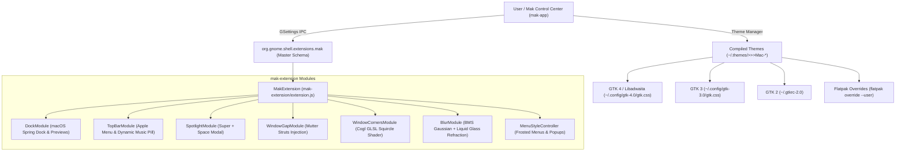
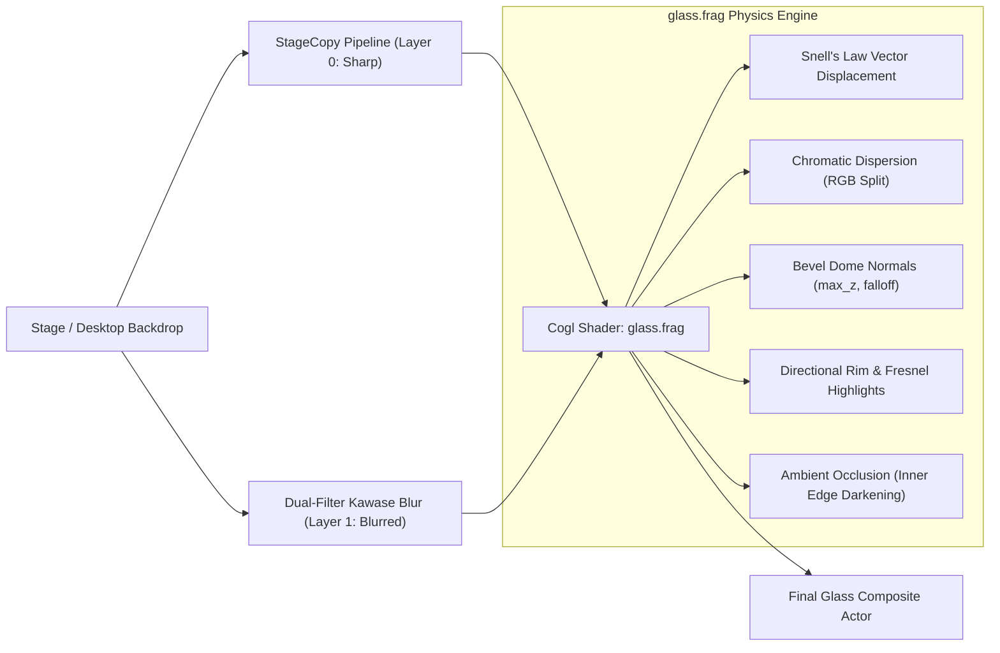

# 🍎 Mak: Master Architecture, System Specification & Implementation Guide

> **Authoritative Technical Documentation**  
> *Target Audience: AI Coding Models, Systems Engineers, GNOME/Mutter Extension Developers, and UI/UX Architects.*  
> *Scope: Complete internal mechanics of the Mak desktop suite, including GNOME Shell extensions, Cogl/GLSL Liquid Glass refraction shaders, Mutter compositor window management, GTK 4 / Libadwaita theming engine, and D-Bus IPC.*

---

## Table of Contents

1. [Executive Summary & Product Vision](#1-executive-summary--product-vision)
2. [Macro Architecture & Codebase Topology](#2-macro-architecture--codebase-topology)
3. [The Core Shell Extension (`mak-extension`)](#3-the-core-shell-extension-mak-extension)
   - 3.1 [Extension Lifecycle & Dynamic Module Loading](#31-extension-lifecycle--dynamic-module-loading)
   - 3.2 [Dock Module (`modules/dock/`)](#32-dock-module-modulesdock)
     - Physics Engine & Spring Solvers
     - Geometry, Magnification & Clutter Hierarchy
     - Autohide, Pressure Barrier & Dwell Sensors
     - Live Window Previews & Genie (Magic Lamp) Minimize Effect
     - Downloads Stack, Stacks Navigation & Trash Monitoring
   - 3.3 [Top Bar & Apple Menu Module (`modules/topbar/`)](#33-top-bar--apple-menu-module-modulestopbar)
     - System Apple Menu & macOS Accelerators
     - Dynamic Music Pill (MPRIS, FFT Visualizers, Lyrics Sync)
     - Quick Settings Customization & Status Pills
     - Force Quit Service & System Windows
   - 3.4 [Spotlight Search Module (`modules/spotlight/`)](#34-spotlight-search-module-modulesspotlight)
     - Modal Overlay & Input Architecture
     - Search Providers Pipeline (Apps, Windows, Files, Math, Web, Weather)
   - 3.5 [Window Management: Gaps & Squircles (`modules/window-gaps/` & `modules/window-corners/`)](#35-window-management-gaps--squircles)
     - Mutter Struts Injection for Persistent Window Gaps
     - Maximized Window Gap Retention
     - Cogl GLSL Squircle Shader & Super-Ellipse Curvature
     - Window Drop Shadows & Chromium Gutter Clipping Elimination
4. [Deep Dive: The Liquid Glass & Refraction Engine](#4-deep-dive-the-liquid-glass--refraction-engine)
   - 4.1 [Optics & Physical Principles (Snell's Law, Fresnel, Chromatic Dispersion)](#41-optics--physical-principles)
   - 4.2 [Dual-Engine Architecture: Blur My Shell vs Liquid Glass](#42-dual-engine-architecture-blur-my-shell-vs-liquid-glass)
   - 4.3 [GLSL Shader Mechanics (`glass.frag`)](#43-glsl-shader-mechanics-glassfrag)
   - 4.4 [Offscreen Stage Copy & Downsample/Upsample Pipeline](#44-offscreen-stage-copy--downsampleupsample-pipeline)
   - 4.5 [Multi-Region Glass Rendering for Quick Settings & Menus](#45-multi-region-glass-rendering-for-quick-settings--menus)
   - 4.6 [Adaptive Contrast Sampling & Dynamic Text Luminance](#46-adaptive-contrast-sampling--dynamic-text-luminance)
   - 4.7 [Liquid Glass Menus & Subtle Frost Calibration](#47-liquid-glass-menus--subtle-frost-calibration)
5. [Theming Architecture & Global Synchronization (`mak-app/theme_manager.py`)](#5-theming-architecture--global-synchronization)
   - 5.1 [Color Palettes: Light, Dark, Amoled, Glassy, Solid](#51-color-palettes-light-dark-amoled-glassy-solid)
   - 5.2 [The GTK CSS Parser Constraints (No `!important`)](#52-the-gtk-css-parser-constraints-no-important)
   - 5.3 [Universal Traffic Light Controls & Anti-Repeat Engine](#53-universal-traffic-light-controls--anti-repeat-engine)
   - 5.4 [Unified Headerbar & Sidebar Aesthetics](#54-unified-headerbar--sidebar-aesthetics)
   - 5.5 [List Views, Column Views, Pathbars & Selection Hover](#55-list-views-column-views-pathbars--selection-hover)
   - 5.6 [Segmented Controls & Split Buttons (Capsule Roundness)](#56-segmented-controls--split-buttons-capsule-roundness)
   - 5.7 [1-Click Multi-Environment Synchronization Pipeline](#57-1-click-multi-environment-synchronization-pipeline)
6. [The Control Center Application (`mak-app`)](#6-the-control-center-application-mak-app)
   - 6.1 [GTK 4 + Libadwaita Architecture](#61-gtk-4--libadwaita-architecture)
   - 6.2 [Settings Bridge & Schema Synchronization](#62-settings-bridge--schema-synchronization)
   - 6.3 [Conflict Sentinel & Conflicting Extension Neutralization](#63-conflict-sentinel--conflicting-extension-neutralization)
7. [Comprehensive Chronology of Work Completed](#7-comprehensive-chronology-of-work-completed)
8. [Technical Constraints, Quirks & Extension Integration Cheatsheet](#8-technical-constraints-quirks--extension-integration-cheatsheet)

---

## 1. Executive Summary & Product Vision

### 1.1 The Problem: "Extension Spaghetti"
Historically, transforming a standard GNOME desktop into an authentic macOS-like environment required installing, configuring, and maintaining 7 to 10 separate GNOME extensions:
- `dash-to-dock` or `aqua-dock-pro` (dock)
- `blur-my-shell` (blur)
- `rounded-window-corners` / `...-reborn` (window roundness)
- `window-gap` / `gnome-maximized-window-gap` (window padding)
- `search-light` (Spotlight search)
- `kiwimenu` / `superbar` / `bar-enhanced` (top bar & Apple menu)
- `transparent-top-bar` / `vibe-panel` (panel translucency)

This fragmented approach inevitably led to severe system instability:
1. **Compositor Shader Collisions**: Multiple extensions attaching custom Cogl pipeline snippets to the same Clutter actors caused rendering artifacts, black rectangular borders, or Shell crashes.
2. **Conflicting Layout Metrics**: Uncoordinated margin adjustments caused docks and panels to overlap or clip window geometries.
3. **Double Borders & Pill Inconsistencies**: GTK 3, GTK 4, Libadwaita, Electron, and Chromium apps rendered conflicting titlebars, misaligned traffic lights, and vertically repeating window buttons.
4. **Fragmented Settings**: Configuring the desktop required opening 8 different preference windows with no unified color or opacity coordination.

### 1.2 The Solution: Mak
**Mak** is a unified, standalone desktop suite for GNOME Shell (supporting versions 45, 46, 47, and 48+). It replaces the entire ecosystem of disparate extensions with a single, coordinated, high-performance extension (`mak-extension`) managed by a native GTK 4 / Libadwaita Control Center (`mak-app`).



---

## 2. Macro Architecture & Codebase Topology

The repository is structured into distinct, decoupled subsystems:

```
/home/parv/projects/mak/
├── mak-extension/                   # Master GNOME Shell Extension
│   ├── extension.js                 # Primary extension entrypoint (GObject lifecycle)
│   ├── metadata.json                # GNOME Shell UUID: "mak@local", shell-version: 45-48
│   ├── stylesheet.css               # Core Shell styles (Dock, Topbar, Menus, Spotlight)
│   ├── app/                         # Helper modal windows (About, Force Quit)
│   ├── icons/                       # Symbolic SVG icons (Apple, Distro logos, Controls)
│   ├── schemas/                     # Compiled GSettings XML schemas
│   └── modules/                     # Subsystem implementations
│       ├── dock/                    # Floating macOS Dock (Physics, Autohide, Previews)
│       ├── topbar/                  # Top Bar, Apple Menu, Dynamic Music Pill
│       ├── spotlight/               # Spotlight Modal (Search Providers, Calculator, Web)
│       ├── window-gaps/             # Mutter workspace struts gap manager
│       ├── window-corners/          # Cogl GLSL Squircle & Drop Shadow Shaders
│       ├── blur/                    # Dual Blur Engine (BMS Gaussian & Liquid Glass)
│       │   ├── bms/                 # Integrated Blur My Shell pipeline
│       │   └── liquid/              # Liquid Glass Hardware Refraction Engine
│       └── appearance/              # Unified menu & popup styling controller
│
├── mak-app/                         # Native GTK 4 + Libadwaita Desktop Control Center
│   ├── main.py                      # Application entrypoint (Adw.Application, UI Pages)
│   ├── settings_bridge.py           # GSettings wrapper, multi-schema bindings & migrations
│   ├── theme_manager.py             # 4,300+ line GTK 2/3/4 CSS compilation engine
│   ├── autostart_manager.py         # Systemd/XDG autostart orchestration
│   ├── generate_monochrome_icons.py # Symbolic icon generator for top bar apps
│   └── mak-app.desktop              # System desktop launcher entry
│
├── themes/                          # Curated Base macOS Themes
│   ├── >>>Mac-Light-solid-purple/   # Clean Apple Light mode
│   ├── >>>Mac-Light-glassy-purple/  # Translucent Apple Light glass
│   ├── >>>Mac-Dark-solid-purple/    # macOS Sonoma Dark mode
│   ├── >>>Mac-Dark-glassy-purple/   # Translucent Graphite glass
│   ├── >>>Mac-Dark-Amoled-purple/   # Pitch Black OLED (#000000)
│   └── >>>Mac-Dark-Amoled-glassy-purple/ # Translucent OLED Obsidian glass
│
└── install.sh                       # Automated dependency audit, compiler, and installer
```

---

## 3. The Core Shell Extension (`mak-extension`)

### 3.1 Extension Lifecycle & Dynamic Module Loading
The extension entrypoint `mak-extension/extension.js` inherits from `Extension` (`resource:///org/gnome/shell/extensions/extension.js`).

**Dynamic Cache-Busting Imports**: To allow hot-reloading during development without restarting the GNOME Shell Wayland compositor, submodules are imported dynamically with timestamp query parameters:
```javascript
const { DockModule: DynamicDock } = await import(`./modules/dock/dockModule.js?v=${Date.now()}`);
this._dock = new DynamicDock(this);
```

**Granular Enablement**: Each module connects to `org.gnome.shell.extensions.mak`. If a feature toggle is switched in `mak-app`, the extension dynamically calls `enable()` or `disable()` on that specific module without tearing down the entire shell session.

---

### 3.2 Dock Module (`modules/dock/`)

The Dock is a faithful recreation of the macOS Aqua/Metal dock, built directly with Clutter actors inside `Main.layoutManager`.

#### 3.2.1 Physics Engine & Spring Solvers
Icon magnification does not use linear interpolation. It implements physical spring-damper dynamics and continuous Gaussian bell-curve falloff:

$$\text{Scale}(x) = 1.0 + (\text{PeakScale} - 1.0) \cdot \exp\left( -\frac{(x - x_{\text{cursor}})^2}{2 \sigma^2} \right)$$

- **Spring Solver** (`animation/springSolver.js`): Solves the second-order differential equation:
  $$m \frac{d^2x}{dt^2} + c \frac{dx}{dt} + k(x - x_{\text{target}}) = 0$$
  This governs the natural bounce of launching application icons and smooth magnification tracking.
- **Frame Scheduler** (`animation/frameScheduler.js`): Syncs animation frames to the compositor's refresh rate using `Clutter.Timeline` and `global.stage.connect('after-paint', ...)`.

#### 3.2.2 Autohide, Pressure Barrier & Dwell Sensors
- **Intellihide / Window Dodge** (`autohide/overlapDetector.js`): Queries `global.display.get_tab_list()` to compute bounding box intersections between open window actors and the dock's monitor-local rect. If an active window enters the dock's footprint, the dock smoothly transitions offscreen.
- **Pressure Barrier** (`autohide/pressureBarrier.js`): On Wayland/X11, when the dock is hidden, a pointer barrier is erected. The user must push against the screen edge with a configurable threshold (default `100px` velocity pressure) or dwell for a set duration before the dock reveals, preventing accidental triggers during gaming or fullscreen browsing.

#### 3.2.3 Live Window Previews & Genie (Magic Lamp) Minimize Effect
- **Live Previews** (`ui/preview/livePreview.js`): Uses `Clutter.Clone` attached to the `Meta.WindowActor`. Hovering over a running dock item instantiates thumbnail previews of all windows belonging to that application, equipped with close buttons and click-to-raise functionality.
- **Genie Effect** (`effects/genie/genieEffect.js`): When a window minimizes to a dock icon, a custom Cogl vertex deformation mesh bends the window rectangle into a funnel towards the target dock icon coordinates, matching the classic macOS Magic Lamp animation.

#### 3.2.4 Stacks & System Services
- **Downloads Stack** (`downloads/downloadsStack.js`): Monitors `~/Downloads` via `Gio.FileMonitor`. Clicking the dock stack item opens an interactive Fan, Grid, or List popup with drag-and-drop file support.
- **Trash Watcher** (`services/trashWatcher.js`): Uses `Gio.File.new_for_uri('trash:///')` to detect file count, automatically updating the dock icon between empty and full wastebasket states.

---

### 3.3 Top Bar & Apple Menu Module (`modules/topbar/`)

#### 3.3.1 System Apple Menu & macOS Accelerators
- **Logo Replacement**: Replaces the default GNOME "Activities" button with an authentic vector Apple icon (or user-selectable distribution logos: Arch, Fedora, Debian, Ubuntu, Linux Tux).
- **macOS Typography & Accelerators**: Dropdown items feature macOS menu symbols:
  - `⌘` (Command / Super)
  - `⌥` (Option / Alt)
  - `⌃` (Control)
  - `⇧` (Shift)
  - `⎋` (Escape)
- **Integrated Actions**:
  - "About This Mac" / System Information modal (`app/aboutWindow.js`).
  - "Force Quit..." dialog (`app/forceQuitWindow.js`) executing `SIGTERM` / `SIGKILL` on unresponsive window PIDs.
  - Software Updates / App Store launcher.
  - Sleep, Restart, and Shut Down with macOS dialogs.

#### 3.3.2 Dynamic Music Pill (`modules/topbar/dynamic-music-pill/`)
An interactive status-bar widget mirroring the macOS / iOS Dynamic Island:
- **MPRIS D-Bus Client** (`controller.js`): Connects to `org.mpris.MediaPlayer2.*` to query playback status, track metadata, and album art.
- **Visualizer Engine** (`visualizerEngine.js`): Renders live audio wave/sine visualizations beside track titles.
- **Synchronized Lyrics Client** (`LyricsClient.js`): Queries online lyric providers, displaying timed lines in an expanded popup overlay (`uiLyricsWidget.js`).

---

### 3.4 Spotlight Search Module (`modules/spotlight/`)

Triggered globally via `Super + Space` (rebound from GNOME's input switcher):
- **Modal Surface**: Centered on the primary monitor with configurable width (400px–1200px) and frosted glass backing.
- **Multi-Engine Routing**:
  - Web searches prefixed with trigger keywords or fallback routing to Google, DuckDuckGo, Brave, Kagi, or Bing.
  - Inline mathematical evaluation via Javascript math parser (e.g., `sin(45) * 128`).
  - Active window switching across all virtual workspaces.
  - Local file indexing via `Tracker3` miner.
  - Live weather forecast queries.

---

### 3.5 Window Management: Gaps & Squircles

#### 3.5.1 Mutter Struts Injection for Persistent Window Gaps (`gapModule.js`)
Standard GNOME window tiling forces maximized windows to touch screen edges. Mak injects virtual struts into `Meta.Workspace`:
```javascript
// Injects margins into Mutter's window placement algorithm
let monitor = Main.layoutManager.primaryMonitor;
let rect = new Meta.Rectangle({
    x: monitor.x + leftGap,
    y: monitor.y + topGap,
    width: monitor.width - (leftGap + rightGap),
    height: monitor.height - (topGap + bottomGap)
});
```
This forces all tiled and **maximized** windows to honor the configured outer gaps (e.g. 12px), creating a floating desktop aesthetic.

#### 3.5.2 Cogl GLSL Squircle Shader & Window Drop Shadows (`cornersModule.js`)
Instead of ugly circular approximations (`border-radius`), Mak compiles a GLSL shader (`rounded_corners.frag`) implementing the true Lamé super-ellipse (squircle):

$$\left| \frac{x}{r} \right|^n + \left| \frac{y}{r} \right|^n \le 1 \quad (n = 0.8)$$

- **Chromium / Electron Gutter Clipping Fix**: Many Wayland/X11 apps (Chrome, VS Code, Spotify) draw client-side decorations that glitch when masked. The shader uses an alpha-preserving bounding-box discard algorithm that prevents black corner artifacts.
- **Realistic Drop Shadows** (`clip_shadow.frag`): Renders multi-stop Gaussian drop shadows with vertical light-source elevation offsets ($+4\text{px}$ down).

---

## 4. Deep Dive: The Liquid Glass & Refraction Engine

The Liquid Glass engine (`mak-extension/modules/blur/liquid/`) is the graphical crown jewel of Mak. It moves beyond flat Gaussian blurs into authentic physical optics, simulating light passing through curved, beveled glass lenses.



### 4.1 Optics & Physical Principles

When light passes through a glass interface, three physical phenomena occur:
1. **Refraction (Snell's Law)**:
   $$n_1 \sin\theta_1 = n_2 \sin\theta_2$$
   Where $n_1 \approx 1.0$ (air) and $n_2 = \text{IOR} \in [1.4, 2.4]$ (glass).
   Light bends as it strikes the curved bevel of the glass element.
2. **Chromatic Dispersion**: The refractive index $n(\lambda)$ varies with wavelength:
   $$n_{\text{blue}} > n_{\text{green}} > n_{\text{red}}$$
   Short wavelengths (blue) bend more than long wavelengths (red), producing prismatic rainbow fringing along high-contrast borders.
3. **Fresnel Reflection**: The reflectance $R(\theta)$ increases dramatically at grazing angles:
   $$R(\theta) = R_0 + (1 - R_0)(1 - \cos\theta)^5$$
   This creates bright, luminous rim highlights along the curved edges of the dock and menus.

---

### 4.2 Dual-Engine Architecture: Blur My Shell vs Liquid Glass

Mak features an intelligent dual-blur compositor coordinator in `blurModule.js`:

| Component | Standard Frosted Mode | Hardware Liquid Glass Mode |
|---|---|---|
| **Top Menu Bar** | BMS Gaussian Pipeline (`pipeline_default`) | Liquid Glass TopBarManager (Snell lens pill) |
| **Dock** | Solid / semi-translucent CSS background | Liquid Glass DockManager with edge bending & chromatic split |
| **Popups & Menus** | BMS Static/Dynamic Blur (`pipeline_default_rounded`) | BMS Refraction Pipeline (`pipeline_liquid_glass`) + Subtle Frost |
| **Quick Settings** | Standard BMS popup blur | Multi-Region Toggle Glass (16 parallel lens rects) |
| **App Windows** | BMS App Blur (Glassy themes only) | Opaque for text clarity (Blacklist for Chrome/Electron) |

---

### 4.3 GLSL Shader Mechanics (`glass.frag`)

The fragment shader is compiled as a Cogl snippet attached to the Clutter actor's pipeline.

#### Uniform Declarations
```glsl
uniform sampler2D cogl_sampler0; // Layer 0: Sharp backdrop capture
uniform sampler2D cogl_sampler1; // Layer 1: Downsampled Kawase blurred capture

uniform float resolution_x, resolution_y;
uniform float corner_radius;
uniform float max_z;              // Dome height: controls normal steepness
uniform float displacement_scale; // Lens bending strength
uniform float ior;                // Index of refraction (1.4 - 2.4)
uniform float chroma_strength;    // Prismatic RGB separation
uniform float edge_smoothing;
uniform float specular_intensity;
uniform float rim_intensity;
uniform float rim_width;
uniform float ao_intensity;       // Ambient occlusion inner darkening
uniform float ao_radius;
```

#### Bevel Normal & Lens Falloff Calculation
The lens edge band is fixed at 22px (`EDGE_LENS_BAND`), ensuring identical bevel curvature across screens of any resolution:
```glsl
#define EDGE_LENS_BAND 22.0
#define EDGE_LENS_FALLOFF 2.4

// Distance from edge 'd' normalized across the lens band
float t = clamp((EDGE_LENS_BAND - dist_to_edge) / EDGE_LENS_BAND, 0.0, 1.0);
float dome_elevation = max_z * pow(1.0 - t, EDGE_LENS_FALLOFF);

// Surface normal computation via partial derivatives
vec2 normal_xy = normalize(vec2(dFdx(dome_elevation), dFdy(dome_elevation)));
```

#### Chromatic Dispersion (Prismatic Split)
The shader samples the sharp and blurred textures across three separate coordinates for Red, Green, and Blue:
```glsl
vec2 refract_offset = normal_xy * displacement_scale * (ior - 1.0);

vec2 uv_r = uv + refract_offset * (1.0 + chroma_strength);
vec2 uv_g = uv + refract_offset;
vec2 uv_b = uv + refract_offset * (1.0 - chroma_strength);

float r = texture2D(cogl_sampler1, uv_r).r;
float g = texture2D(cogl_sampler1, uv_g).g;
float b = texture2D(cogl_sampler1, uv_b).b;
vec4 refracted_backdrop = vec4(r, g, b, 1.0);
```

#### Fresnel Grazing Rim & Ambient Occlusion
```glsl
// Fresnel approximation
float fresnel = pow(clamp(1.0 - dot(vec3(0.0, 0.0, 1.0), normal), 0.0, 1.0), 3.0);
vec3 rim_highlight = vec3(1.0) * fresnel * rim_intensity;

// Inner Ambient Occlusion darkening
float ao = smoothstep(0.0, ao_radius, dist_to_edge);
refracted_backdrop.rgb *= mix(1.0 - ao_intensity, 1.0, ao);

// Final color synthesis
gl_FragColor = vec4(refracted_backdrop.rgb + rim_highlight, alpha);
```

---

### 4.4 Multi-Region Glass Rendering for Quick Settings & Menus

Instead of spawning 16 separate Cogl offscreen pipelines for each toggle in GNOME's Quick Settings (which would destroy GPU performance), `glass.frag` features **Multi-Region Batch Mode**:
```glsl
#define MAX_GLASS_REGIONS 16
uniform float multi_region_mode;
uniform float region_count;
uniform float region_x[MAX_GLASS_REGIONS];
uniform float region_y[MAX_GLASS_REGIONS];
uniform float region_w[MAX_GLASS_REGIONS];
uniform float region_h[MAX_GLASS_REGIONS];
```
A single fullscreen blurred texture is bound once. The fragment shader checks which toggle rectangle the current pixel belongs to and applies the lens refraction locally in a single draw pass.

---

### 4.5 Liquid Glass Menus & Subtle Frost Calibration

In context menus and dropdowns, high refraction over high-contrast wallpapers (such as bright text over dark wallpaper or vice-versa) can impair text readability.
Mak solves this via `menuStyleController.js`:
- Under liquid glass mode, context menus and popups receive a **delicate, translucent frost backing**:
  - **Light Mode**: `rgba(255, 255, 255, 0.28)`
  - **Dark Mode**: `rgba(30, 30, 34, 0.32)`
  - **Amoled Mode**: `rgba(18, 18, 22, 0.36)`
- This calibrated opacity maintains crystal-clear text contrast while preserving the backdrop refraction, specular highlights, and wallpaper visibility.

---

## 5. Theming Architecture & Global Synchronization (`mak-app/theme_manager.py`)

The theming engine in `mak-app/theme_manager.py` (4,300+ lines of Python) generates and maintains 6 distinct macOS desktop themes in `~/.themes/>>>Mac-*` and coordinates global styling across all toolkits.

### 5.1 Color Palettes: Light, Dark, Amoled, Glassy, Solid

```python
# Unified Design Palettes
PALETTES = {
    'light': {
        'bg': '#f6f6f8',
        'sidebar_bg': '#ececf0',
        'header_bg': '#ececf0',
        'text_primary': '#1d1d1f',
        'text_secondary': 'rgba(0, 0, 0, 0.50)',
        'accent': '#9d4edd', # Purple accent
        'border': 'rgba(0, 0, 0, 0.12)',
        'alt_row_bg': 'rgba(0, 0, 0, 0.024)',
        'row_hover_bg': 'rgba(0, 0, 0, 0.05)',
    },
    'dark': {
        'bg': '#1e1e22',
        'sidebar_bg': '#28282c',
        'header_bg': '#28282c',
        'text_primary': '#f5f5f7',
        'text_secondary': 'rgba(255, 255, 255, 0.50)',
        'accent': '#a855f7',
        'border': 'rgba(255, 255, 255, 0.12)',
        'alt_row_bg': 'rgba(255, 255, 255, 0.028)',
        'row_hover_bg': 'rgba(255, 255, 255, 0.06)',
    },
    'amoled': {
        'bg': '#000000',
        'sidebar_bg': '#0c0c0e',
        'header_bg': '#0c0c0e',
        'text_primary': '#ffffff',
        'text_secondary': 'rgba(255, 255, 255, 0.55)',
        'accent': '#a855f7',
        'border': 'rgba(255, 255, 255, 0.15)',
        'alt_row_bg': 'rgba(255, 255, 255, 0.035)',
        'row_hover_bg': 'rgba(255, 255, 255, 0.08)',
    }
}
```

---

### 5.2 The GTK CSS Parser Constraints (No `!important`)

> [!CAUTION]
> **GTK CSS does NOT support `!important`.**
> Unlike web browsers, the GTK 3 and GTK 4 CSS parsers treat `!important` as an **invalid CSS token**. Any rule containing `!important` is discarded in its entirety by GTK, causing severe silent styling regressions and terminal warnings.

To achieve guaranteed style precedence over upstream WhiteSur styles and libadwaita defaults, Mak relies purely on **Selector Specificity Stacking**:

```css
/* Weak (Gets overridden by libadwaita): */
splitbutton > button { background: transparent; }

/* Infallible Mak Specificity (0, 3, 3): */
window headerbar splitbutton > button.flat,
window headerbar splitbutton menubutton > button {
    background: transparent;
    background-color: transparent;
    box-shadow: none;
    border: none;
}
```

---

### 5.3 Universal Traffic Light Controls & Anti-Repeat Engine

A common bug in Linux macOS themes is window control buttons repeating vertically or showing double icons in Chromium, Google Chrome, Brave, and Electron applications.

Mak enforces an **Anti-Repeat Traffic Light System** across both GTK 3 and GTK 4:
```css
/* Eliminates vertical repeat and enforces exact circular geometry */
headerbar windowhandle > box.start > button.titlebutton,
headerbar windowcontrols > button.close,
headerbar windowcontrols > button.minimize,
headerbar windowcontrols > button.maximize,
window.csd > headerbar button.titlebutton {
    min-width: 14px;
    min-height: 14px;
    max-width: 14px;
    max-height: 14px;
    padding: 0;
    margin: 0 4px;
    border-radius: 9999px;
    background-repeat: no-repeat;
    background-position: center;
    background-size: 14px 14px;
    border: none;
    box-shadow: none;
}

/* Subtle inset symbols reveal ONLY on window hover */
headerbar:hover windowcontrols > button.close {
    background-image: -gtk-scaled(url("assets/titlebutton-close-hover.svg"));
}
```

---

### 5.4 Unified Headerbar & Sidebar Aesthetics

In modern macOS (Sonoma/Sequoia), the Finder window topbar and sidebar share the exact same background shade without harsh borders.
Mak synchronizes this in `theme_manager.py`:
- `.nautilus-window headerbar` and `.nautilus-window .sidebar` use identical `{header_bg}` and `{sidebar_bg}` colors.
- Floating sidebar border frames are stripped:
  ```css
  .nautilus-window paned > separator {
      background-color: {border_color};
      min-width: 1px;
  }
  ```
- Maximized window borders remain visible by compensating for 1px clip bounds.

---

### 5.5 List Views, Column Views, Pathbars & Selection Hover

#### 5.5.1 The Nautilus Selection Hover Fix
In Nautilus (Files), when an item (such as a folder or file) is selected, its text turns `#ffffff`. A critical bug occurred where hovering over an already-selected row applied `{hover_subtle}` (faint white), turning the background white and making white text completely invisible.

Mak resolves this by scoping the hover selector and explicitly protecting `:selected:hover`:
```css
/* Normal rows receive subtle hover only when NOT selected */
list > row.activatable:hover:not(:selected),
listview > row.activatable:hover:not(:selected),
columnview row:hover:not(:selected) {
    background-color: rgba(0, 0, 0, 0.05);
}

/* Selected rows retain the accent background and white text when hovered */
list > row.activatable:selected,
list > row.activatable:selected:hover,
listview > row.activatable:selected,
listview > row.activatable:selected:hover,
columnview row:selected,
columnview row:selected:hover {
    background-color: @accent_bg_color;
    color: @accent_fg_color;
}

list > row.activatable:selected label,
list > row.activatable:selected:hover label,
listview > row.activatable:selected label,
listview > row.activatable:selected:hover label,
columnview row:selected label,
columnview row:selected:hover label {
    color: #ffffff;
}
```

#### 5.5.2 Transparent Breadcrumbs & Column Headers
- **Path Buttons** (`.nautilus-pathbar button`, `filechooser pathbar button`): Stripped of background pills at rest (`background: transparent`), showing clean text/icons that highlight only on hover.
- **Column Header Buttons** ("Name", "Size", "Date Modified"): Styled with flat Apple Sans typography (`font-weight: 600; font-size: 11px`), with transparent backgrounds and no borders.

---

### 5.6 Segmented Controls & Split Buttons (Capsule Roundness)

In terminal apps (`kgx`, `gnome-terminal`) and file managers, split buttons (e.g. `[ + | v ]`) often suffer from two issues:
1. Low rectangular border radiuses (`6px` or `5px`) clashing with macOS pill buttons.
2. "Double buttons" — inner buttons inheriting their own background and pill borders, sitting awkwardly inside an outer container.

Mak enforces **Capsule Roundness (`9999px`)** and strips inner buttons:
```css
/* Outer capsule container */
window headerbar splitbutton,
window headerbar .linked,
headerbar splitbutton,
splitbutton {
    border-radius: 9999px;
    background-color: {linked_bg};
    border: 1px solid {linked_border};
    box-shadow: 0 1px 2px rgba(0, 0, 0, 0.06);
    padding: 0;
}

/* Force all inner buttons to be completely transparent at rest */
window headerbar splitbutton button,
window headerbar splitbutton menubutton > button,
headerbar splitbutton button,
splitbutton button {
    background: transparent;
    background-color: transparent;
    border: none;
    box-shadow: none;
    outline: none;
}

/* Left button: capsule rounded on left, 0 on right */
headerbar splitbutton > button:dir(ltr),
splitbutton > button:dir(ltr) {
    border-top-left-radius: 9999px;
    border-bottom-left-radius: 9999px;
    border-top-right-radius: 0;
    border-bottom-right-radius: 0;
}

/* Right dropdown button: capsule rounded on right, 0 on left */
headerbar splitbutton > menubutton > button:dir(ltr),
splitbutton > menubutton > button:dir(ltr) {
    border-top-right-radius: 9999px;
    border-bottom-right-radius: 9999px;
    border-top-left-radius: 0;
    border-bottom-left-radius: 0;
}
```

---

### 5.7 1-Click Multi-Environment Synchronization Pipeline

When a user switches themes in `mak-app`, `apply_global_theme(theme_name)` executes the following atomic operations:
1. **GSettings Configuration**:
   ```bash
   gsettings set org.gnome.desktop.interface gtk-theme ">>>Mac-Light-solid-purple"
   gsettings set org.gnome.desktop.interface color-scheme "prefer-light"
   gsettings set org.gnome.shell.extensions.user-theme name ">>>Mac-Light-solid-purple"
   ```
2. **GTK 4 / Libadwaita Sync**: Copies compiled CSS directly to `~/.config/gtk-4.0/gtk.css` and `gtk-dark.css`.
3. **GTK 3 Sync**: Copies compiled CSS to `~/.config/gtk-3.0/gtk.css` and `gtk-dark.css`.
4. **GTK 2 Sync**: Writes `~/.gtkrc-2.0` pointing to the theme assets.
5. **Flatpak Sandbox Override**:
   Executes `flatpak override --user --filesystem=xdg-config/gtk-4.0:ro --filesystem=xdg-config/gtk-3.0:ro --filesystem=~/.themes:ro` ensuring sandboxed apps (Spotify, Discord, Steam) match the desktop theme instantly.
6. **Live App Notification**: Signals `nautilus -q` and D-Bus theme interfaces for immediate live repainting.

---

## 6. The Control Center Application (`mak-app`)

### 6.1 GTK 4 + Libadwaita Architecture
`mak-app` is built natively in Python using `PyGObject`, `Gtk 4.0`, and `Adw 1`.
It avoids generic tabs in favor of `Adw.PreferencesWindow` and `Adw.PreferencesPage`:
- **Dock Page**: Icon dimensions, physics sliders, autohide delays, indicators, stacks.
- **Top Bar Page**: Apple logo picker, clock formats, music pill visualizer toggles.
- **Window Management Page**: Gap dimensions, squircle radius, drop shadow elevation.
- **Spotlight Page**: Trigger shortcut, search provider order, modal width.
- **Glass & Blur Page**: Master toggle, sigma, refraction strength, chromatic dispersion, edge bending, glass levels.
- **Themes Page**: 1-click switcher between the 6 curated macOS styles.

### 6.2 Settings Bridge & Schema Synchronization (`settings_bridge.py`)
`settings_bridge.py` wraps `Gio.Settings` with type-safe getter/setter caching and bi-directional UI widget binding. Changing a slider in `mak-app` writes immediately to `org.gnome.shell.extensions.mak`, firing GSettings signals that update the live shell actors in real time without lag.

### 6.3 Conflict Sentinel
On startup, `mak-app` and `install.sh` query `gnome-extensions list --enabled`. If any of the 16 legacy conflicting extensions (e.g. `blur-my-shell`, `dash-to-dock`, `rounded-window-corners`) are detected, the user is warned and guided to disable them with 1 click to prevent compositor crashes.

---

## 7. Comprehensive Chronology of Work Completed

Below is a record of key development milestones and architectural problems solved:

```
┌──────────────────────────────────────────────────────────────────────────────────┐
│                             CHRONOLOGY OF WORK                                  │
├─────────────────┬────────────────────────────────────────────────────────────────┤
│ MILESTONE       │ DETAILS & ACHIEVEMENTS                                         │
├─────────────────┼────────────────────────────────────────────────────────────────┤
│ 1. Suite Fusion │ Consolidated 7+ disparate extensions into `mak-extension`.     │
│                 │ Created unified master schema `org.gnome.shell.extensions.mak`.│
│                 │ Resolved namespace collisions in Clutter actors and timelines. │
├─────────────────┼────────────────────────────────────────────────────────────────┤
│ 2. Control App  │ Built native GTK 4 + Libadwaita Control Center (`mak-app`).    │
│                 │ Exposed 140+ granular preferences across 8 organized pages.    │
│                 │ Implemented `SettingsBridge` and `ConflictSentinel`.           │
├─────────────────┼────────────────────────────────────────────────────────────────┤
│ 3. Liquid Glass │ Ported advanced physical refraction shader (`glass.frag`).     │
│    Engine       │ Implemented Snell's law bending, dome normals, and chromatic   │
│                 │ dispersion (RGB prism fringing). Integrated multi-region batch │
│                 │ rendering for Quick Settings toggles.                          │
├─────────────────┼────────────────────────────────────────────────────────────────┤
│ 4. Window Mgmt  │ Injected Mutter struts to retain window gaps when maximized.   │
│                 │ Developed GLSL squircle corner shader with super-ellipse n=0.8.│
│                 │ Solved Chromium/Electron gutter clipping and black box corners.│
├─────────────────┼────────────────────────────────────────────────────────────────┤
│ 5. Apple Bar &  │ Created macOS menu bar with vector Apple icon and accelerators.│
│    Music Pill   │ Integrated MPRIS D-Bus client, live audio visualizer, and live │
│                 │ online synchronized lyrics fetcher.                            │
├─────────────────┼────────────────────────────────────────────────────────────────┤
│ 6. Spotlight    │ Implemented `Super + Space` modal overlay with multi-provider  │
│                 │ routing (apps, open windows, files, math evaluator, web).      │
├─────────────────┼────────────────────────────────────────────────────────────────┤
│ 7. Theme Engine │ Built 4,300+ line `theme_manager.py` generating 6 macOS styles.│
│                 │ Implemented universal anti-repeat traffic lights. Eliminated   │
│                 │ `!important` to satisfy strict GTK CSS parser rules.           │
│                 │ Synchronized topbar & sidebar background palettes.             │
├─────────────────┼────────────────────────────────────────────────────────────────┤
│ 8. Recent Polish│ - Fixed Nautilus list view hover turning selected text white.  │
│    Pass         │ - Upgraded split buttons to capsule roundness (9999px).        │
│                 │ - Eliminated double-button pill layering in terminal/headers.  │
│                 │ - Made path buttons and column headers transparent at rest.    │
│                 │ - Calibrated subtle frost tint (0.28-0.36) for liquid menus.   │
└─────────────────┴────────────────────────────────────────────────────────────────┘
```

---

## 8. Technical Constraints, Quirks & Extension Integration Cheatsheet

### 8.1 GNOME Shell / Mutter Constraints
1. **Wayland vs X11 Input Barriers**: `Meta.Barrier` operates differently across backends. Under Wayland, pointer pressure events require listening to `Clutter.PointerDevice` relative motion deltas.
2. **Actor Reparenting in GNOME Shell 46+**: `Main.panel` children cannot simply be reassigned with `actor.reparent()`. Always use `actor.get_parent().remove_child(actor)` followed by `new_parent.add_child(actor)`.
3. **ClutterClone Caveat**: Previews cloned with `new Clutter.Clone({ source: windowActor })` will render black if the window is fully occluded or unmapped. Mak keeps window actors mapped offscreen when minimized to ensure live thumbnails render properly.

### 8.2 GTK CSS Engineering Rules
1. **Never use `!important`**: GTK will reject the selector or throw parser errors. Elevate specificity using ancestor selectors: `window.background.csd headerbar splitbutton > button.flat`.
2. **Corner Radii on Linked Children**: When styling `.linked` or `splitbutton`, ALWAYS override `:dir(ltr)` and `:dir(rtl)` specifically. Upstream CSS often hardcodes `button:dir(ltr) { border-top-right-radius: 9999px; }` which will deform custom corner geometries unless explicitly reset to `0`.
3. **Hover States on Selection**: Always specify `:hover:not(:selected)` for standard row hovers, and explicitly define `:selected:hover` with `@accent_bg_color` and `#ffffff` text to prevent contrast collapse.

### 8.3 Cogl GLSL Shader Rules
1. **Snippet Hooks**: Always insert shaders using `Cogl.SnippetHook.FRAGMENT` or `Cogl.SnippetHook.VERTEX`. Never attempt raw OpenGL context binding under Mutter Wayland.
2. **Texel Normalization**: Clutter texture samplers use normalized coordinates $[0.0, 1.0]$. Remember that downsampled blur passes run at $1/2$ or $1/4$ resolution; divide by `blur_tex_w` and `blur_tex_h` when computing texel offsets for blurring.

---

## 9. Conclusion & Developer Onboarding

With this document, any engineer or AI language model has complete conceptual, mathematical, architectural, and practical knowledge of **Mak**. 

Every module is designed around clean separation of concerns:
- Low-level graphics live in **GLSL/Cogl**.
- Shell layout and desktop widgets live in **Clutter/GObject (`mak-extension`)**.
- Theming and visual styling live in **GTK CSS (`theme_manager.py`)**.
- User preferences and IPC live in **GSettings & Libadwaita (`mak-app`)**.

Mak transforms GNOME into a high-performance, visually breathtaking, and unified macOS workstation.
