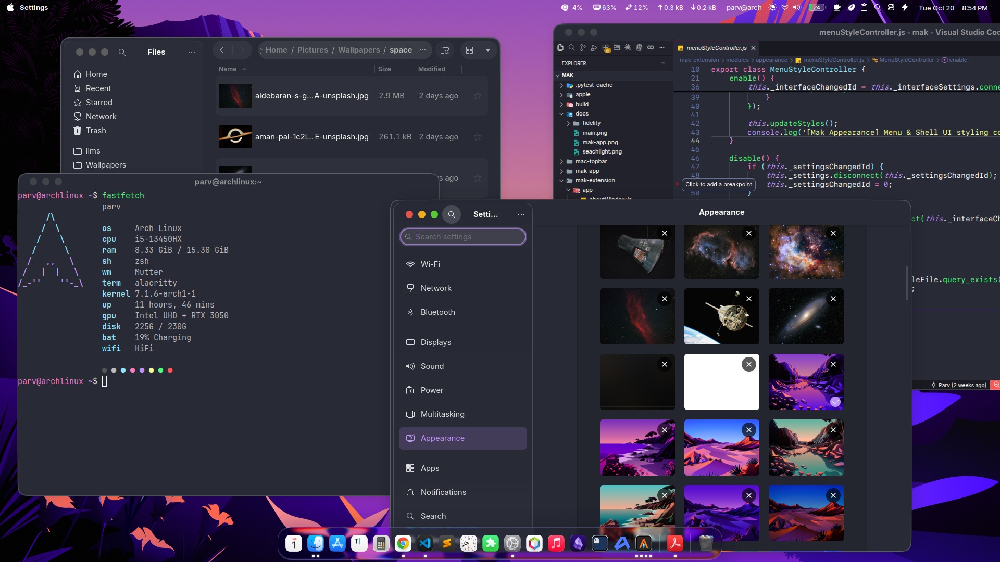
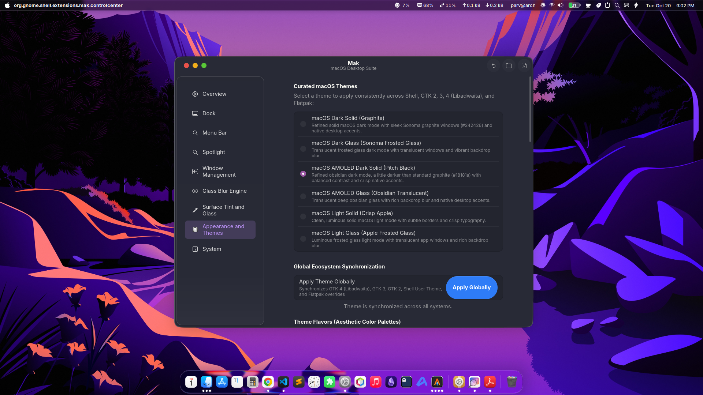
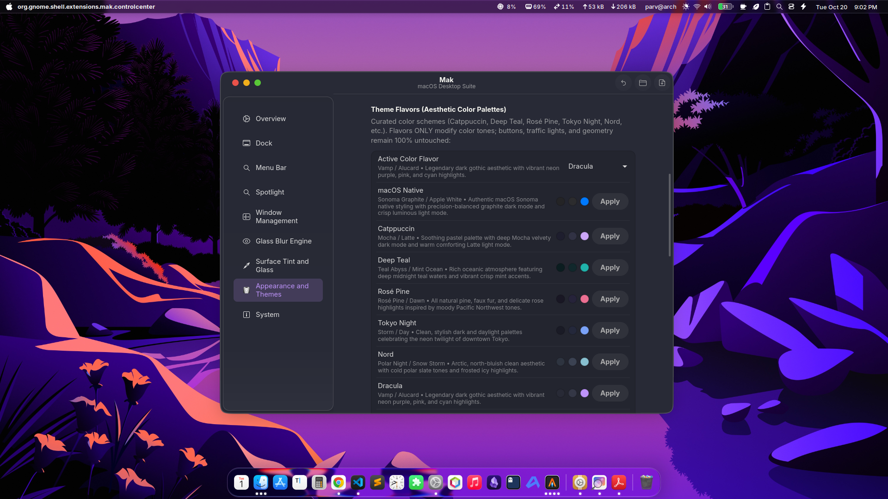
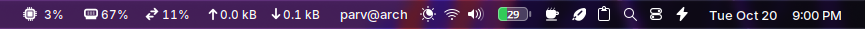
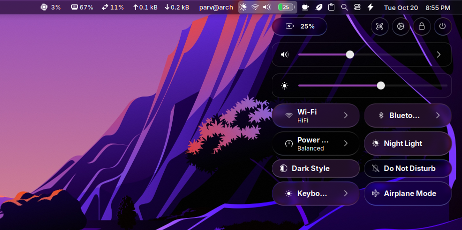
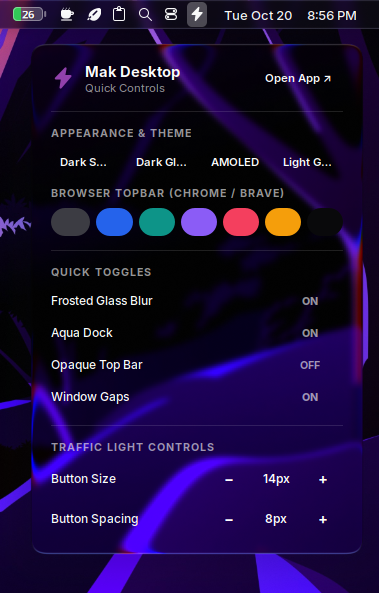
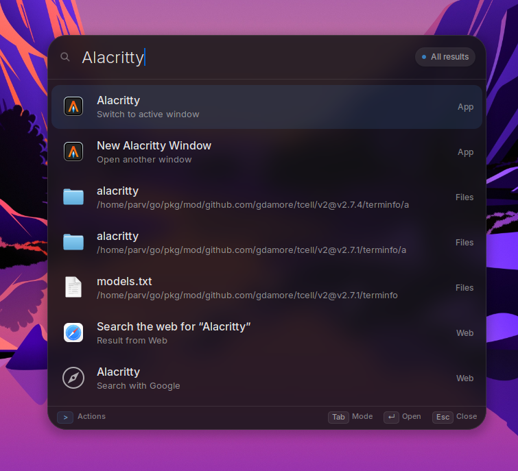
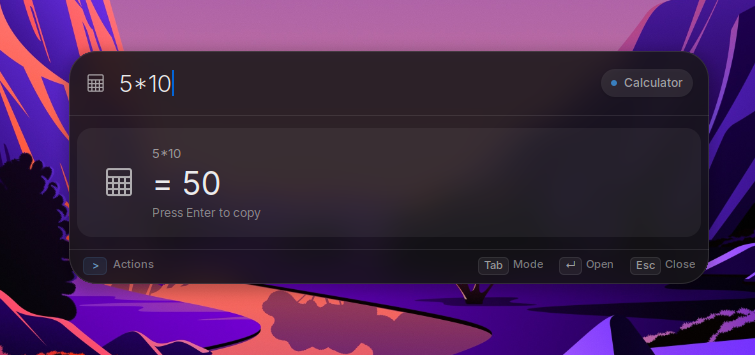
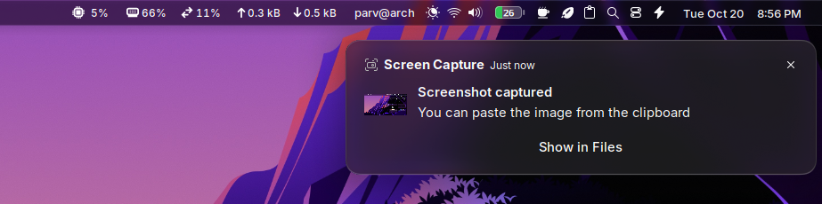

# Mak: Unified macOS Desktop Experience for GNOME

[](https://www.gnome.org/)
[](https://gnome.pages.gitlab.gnome.org/libadwaita/)
[](https://wayland.freedesktop.org/)
[](LICENSE)

Mak transforms your standard GNOME desktop into a polished, authentic macOS environment. Instead of forcing you to hunt down, install, and constantly debug seven different third-party extensions that break every time GNOME updates, Mak packages everything into a single, conflict-free suite.

From a physics-based magnifying dock and a translucent top menu bar with an Apple menu, to native squircle window shaders, outer window gaps, hardware-accelerated blur, and an instant Spotlight search modal (`Super + Space`), Mak provides the complete experience out of the box.



---

## Architecture: How Mak Works

Mak is divided into two focused components:

1. **The Mak App (`mak-app`) — Your Control Center**
   A standalone GTK 4 and Libadwaita application where you customize everything. Theme flavors, dock physics, traffic light button sizes, gap padding, corner radii, blur strengths, and color tints are all configured here in real-time. It can also export and import your configurations as JSON files.
2. **The Mak Extension (`mak@local`) — The Background Engine**
   A single GNOME Shell extension running quietly in the background. It implements the Cogl GLSL shaders, hooks Mutter's window layout for outer padding, manages the dock and top bar actors, and listens to the settings you pick in the Mak App.

**The Golden Rule:** You just keep the Mak extension turned ON, open the Mak App whenever you want to tweak something, and let the suite handle the rest.

---

## Visual Showcase

### Mak App: Control Center
The main hub for customizing your setup. Switch between curated color flavors (Tokyo Night, Rosé Pine, Catppuccin, Nord, etc.), tweak browser top bar accents, or adjust hardware blur in real-time.



Fine-tune outer screen gaps, squircle curvature smoothing, traffic light button diameters, and realistic window drop shadows without touching a single CSS file by hand.



---

### Top Menu Bar & Quick Settings
A clean, translucent top panel featuring the system Apple menu, active application title, media controls, and status indicators.



Clicking the control center icon opens a macOS Big Sur / Sonoma styled Quick Settings card with hardware glass blur, volume/brightness sliders, and quick toggle capsules.



You can also access Mak's quick toggles directly from the top bar tray menu:



---

### Spotlight Search Modal (`Super + Space`)
Press `Super + Space` anywhere to bring up Searchlight. Launch apps, switch between active windows, search files, or solve math calculations on the fly.





---

### Frosted Glass Notifications & Popups
Notifications and popup menus feature hardware-accelerated Gaussian blur, specular highlight rims, and smooth rounded corners matching the active palette.



---

## Core Features Breakdown

### 1. Curated Themes & Aesthetic Color Flavors
Mak ships with 6 base themes and 11 aesthetic color flavors that style GTK 2, GTK 3, GTK 4 (Libadwaita), GNOME Shell, and Flatpak applications synchronously:

- **Theme Flavors:** Tokyo Night, Rosé Pine (Dawn/Dusk), Catppuccin (Mocha/Latte), Nord, Dracula, Gruvbox, Deep Teal, Cyberpunk, Monokai, Everforest, and Apple Default.
- **Mac Tahoe Floating Sidebars:** Applications with sidebars (like Files / Nautilus) get a floating card surface with subtle outer borders, drop shadows, and seamless header blending.
- **Browser Top Bar Frame Accents:** Dedicated anti-repeat rules for Chromium, Google Chrome, Brave, and Electron apps that prevent tiled traffic lights and let you pick custom header frame colors.
- **System Accent Colors:** Quick swatches for Blue, Teal, Green, Yellow, Orange, Red, Pink, Purple, and Slate.

### 2. The Floating Aqua Glass Dock
- **Magnification Physics:** Smooth spring physics and customizable zoom factors as your cursor glides across icons.
- **Liquid Glass Shader:** Optical depth, physical edge refraction (Snell's law curvature bending), and customizable glass tint overlays.
- **Multi-Monitor & Smart Autohide:** Choose which screen edge the dock lives on, display it across all monitors, isolate workspaces, or configure pressure-sensitive autohide.
- **Window Previews & Badges:** Live window thumbnail previews on hover and desktop notification badges.

### 3. Top Menu Bar & Apple Menu
- **Apple System Menu:** Quick access to About This System, System Settings, App Store launcher, Force Quit, Sleep, Restart, and Shut Down.
- **Dynamic Frosted Glass:** Adapts transparency when windows maximize or touch the top bar.
- **macOS Typography & Indicators:** Clean accelerator symbols and native battery percentage indicator.

### 4. Window Geometry: Squircles, Gaps & Shadows
- **Apple Squircle Shaders:** Uses super-ellipse curvature exponent ($n = 0.8$) anti-aliased via Cogl GLSL shaders on Mutter actors, avoiding jagged corners.
- **Outer Window Gaps:** Injects outer desktop padding around application windows. You can choose uniform margins or individual edge controls, and keep gaps active even when windows are maximized.
- **Traffic Light Controls:** Adjust the exact diameter and inter-button spacing of close, minimize, and maximize buttons.
- **Elevation Drop Shadows:** Separate vertical offset, blur radius, and opacity settings for focused windows versus background windows.

### 5. Spotlight Search (`Super + Space`)
- Triggered instantly via keyboard shortcut.
- Search applications, active windows, files, and settings.
- Inline math evaluation engine (type `48 * 12` or `sqrt(144)` and get immediate answers).

### 6. Settings Backup & Portability
- Export your entire desktop setup into a single `.json` file.
- Restore settings anytime or share presets with friends.
- One-click "Reset Defaults" button to return to authentic macOS metrics whenever needed.

---

## Why Mak Instead of Disparate Extensions?

If you have ever tried turning GNOME into macOS manually, you already know the story:
You install Blur My Shell, Dash to Dock, Rounded Window Corners, Window Gaps, Searchlight, Kiwi Menu, and a handful of user themes. Two days later, a GNOME update hits, three of them crash your compositor, your dock overlaps your top bar, and your Chromium tabs render four duplicate close buttons.

| Feature | The Old Way (Disparate Extensions) | The Mak Way (Unified Suite) |
|---|---|---|
| **Dock** | `dash-to-dock` or `aqua-dock-pro` | **Built-in Floating Glass Dock** with spring magnification |
| **Top Bar** | `superbar`, `kiwimenu`, `transparent-top-bar` | **Built-in Top Menu Bar & Apple Menu** with dynamic glass |
| **Spotlight** | `search-light` | **Built-in Spotlight Modal** (`Super + Space`) |
| **Window Gaps** | `window-gap` | **Built-in Struts Layout Engine** (retained when maximized) |
| **Squircles** | `rounded-window-corners` / `...-reborn` | **Built-in Cogl GLSL Squircle Shader** |
| **Glass Blur** | `blur-my-shell` | **Built-in Hardware-Accelerated Blur Engine** |
| **Configuration** | 6 different preference dialogs | **Single Control Center** (`mak-app`) with JSON export |
| **Theme Sync** | Manual CSS tweaks and broken GTK 3/4 borders | **Unified Flavor System** with zero-impact control metrics |

---

## Prerequisites

Before installing Mak, make sure you have the required runtime dependencies:

### Arch Linux / EndeavourOS / Manjaro
```bash
sudo pacman -S python-gobject gtk4 libadwaita glib2 gnome-shell-extensions
```

### Fedora
```bash
sudo dnf install python3-gobject gtk4 libadwaita glib2 gnome-shell-extension-user-theme
```

### Ubuntu / Debian (23.10+)
```bash
sudo apt install python3-gi gir1.2-gtk-4.0 gir1.2-adw-1 libglib2.0-bin gnome-shell-extension-manager
```

---

## Installation

1. **Clone the repository:**
   ```bash
   git clone https://github.com/parv141206/mak.git
   cd mak
   ```

2. **Run the interactive installer:**
   ```bash
   ./install.sh
   ```

   The installer automatically checks dependencies, compiles the GSettings schemas, copies the curated themes into `~/.themes`, registers the desktop launcher, and audits for conflicting extensions.

3. **Non-interactive / Automated install:**
   If you want Mak to automatically disable known conflicting legacy extensions without asking prompts, use:
   ```bash
   ./install.sh -y --disable-conflicts
   ```

4. **Start customizing:**
   Launch **Mak** from your application menu or run:
   ```bash
   mak-app
   ```

> **Note for Wayland Sessions:** GNOME Shell on Wayland does not allow in-place restarts (`Alt + F2 -> r`). If the extension does not appear immediately after running the installer, simply log out and log back in, or run:
> ```bash
> gnome-extensions enable mak@local
> ```

---

## Uninstallation

If you ever want to revert everything cleanly:

```bash
./install.sh --uninstall
```

This disables the extension, cleans up schema files, deletes `~/.local/bin/mak-app`, and removes the desktop entry.

---

## License

Distributed under the **GPL-3.0 License**. See [LICENSE](LICENSE) for details.
